```json
{
  "name": "Do Quang Huan",
  "alias": "Huan",
  "location": "Hanoi, Vietnam",
  "profession": "Java Backend Developer @ Viettel",
  "tech_stack": [
    "Java",
    "Spring Boot",
    "Spring Webflux",
    "Microservices",
    "Kubernetes"
  ],
  "companions": ["cat"]
}
```
<div align="center">
  <a href="https://linkedin.com/in/itsHuaan" target="_blank">
    
  </a>
  <a href="https://x.com/itsHuaan" target="_blank">
    
  </a>
  <a href="mailto:doquanghuan1909@gmail.com" target="_blank">
    
  </a>
  <a href="https://facebook.com/itsHuaan" target="_blank">
    
  </a>
</div>